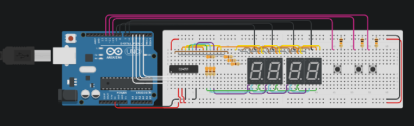

# 7-Segment-Display-Multiplex-Clock
A 24-hour clock Arduino project, using four 7-segment displays multiplexed into one CD4511. The Tinkercad simulation can be accessed [here](https://www.tinkercad.com/things/9KLFnK1CIMQ-7-segment-display-multiplex-clock).

This was done back in high school when we were attending Integrated Technical Course in Electronics (a TVE program) at the Instituto Federal de Goiás (IFG).

## Usage
To adjust the time, follow the steps:
  1. Press the Adjust button (the first one from left to right);
  2. Use the other two (Decrease and Increase, respectively) buttons to adjust the hours;
  3. Do steps 1 and 2 again to adjust the minutes;
  4. Press the Adjust button and then the Increase button for the clock to run.

## Preview

    

